<p align="center">
  
</p>

```python
class Aarez:
    name      = "Aarez Ashhar"
    based_in  = "Chennai, India"
    studying  = "B.E. AI & ML @ MSAJCE (class of 2028)"
    goal      = ["ML Engineer", "start a company, after real industry experience"]
    learning  = ["machine learning fundamentals", "Python (OOP)", "full-stack with MERN"]
    style     = "ship it, break it, fix it, repeat"
```

&nbsp;

### `01` — What I'm building

| Project | What it does | Stack |
| :-- | :-- | :-- |
| [**planttalk-ai**](https://github.com/aarezashhar-tech/planttalk-ai) | Farming intelligence web app, built with a teammate | JavaScript, full-stack |
| [**Student-Registration-Form**](https://github.com/aarezashhar-tech/Student-Registration-Form) | Student registration app for my college, with PRD and design docs | React, Vite |
| [**campus-lost-found**](https://github.com/aarezashhar-tech/campus-lost-found) | A lost-and-found board for campus | HTML |

&nbsp;

### `02` — Toolbox

`JavaScript` · `React` · `Vite` · `Node.js` · `Express` · `MongoDB` · `Python` · `Git` · `VS Code`

Design side: layout, typography, and clean UI. I care how things look, not only how they run.

&nbsp;

### `03` — Now

- [x] Shipping small, real projects instead of tutorial clones
- [ ] Moving from web apps toward ML projects (data → model → deployed app)
- [ ] Looking for an AI/ML internship

&nbsp;

### `04` — Find me

[](mailto:aarezashhar510@gmail.com)
<!-- Add yours: -->
<!-- [](https://linkedin.com/in/YOUR-HANDLE) -->

<sub>Built this README by hand. No visitor counters, no 40 badges.</sub>
